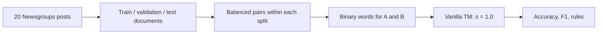

# Vanilla TM document-pair experiment

This project asks whether two 20 Newsgroups posts have the same category. It uses the **vanilla** `bittm.TsetlinMachine` with `s=1.0`. This repository is a research prototype; outputs are measured only when you run it. No sample scores in this document are results.

**Start with [docs/REPORT.md](docs/REPORT.md)** (the unified academic report) or **[docs/README.md](docs/README.md)**: theory, code walkthrough, and measured results with figures. [`docs/archive/EXPERIMENT_GUIDE.md`](docs/archive/EXPERIMENT_GUIDE.md) describes only the first run and is kept for history.

## Setup

Use 64-bit CPython 3.12 and uv on Windows. The bundled training wheel works without Git access or a C++ compiler. From this project folder run the following commands. Linux source installs use requirements.txt and require access to the pinned BitTM repository.

```powershell
uv venv --python 3.12 .venv
uv pip install --python .venv\Scripts\python.exe -r requirements-windows.txt
.\.venv\Scripts\python.exe -m pytest tests -q
$env:SCIKIT_LEARN_DATA = (Join-Path (Get-Location) "data")
.\.venv\Scripts\python.exe run.py --smoke --output outputs/smoke
.\.venv\Scripts\python.exe run.py --output outputs/validation
```

After choosing settings from validation, run once with `--final-test` and the exact chosen flags. The run script does not enforce a frozen configuration, so compare your flags and inputs with [the frozen submission record](docs/results/submission_freeze.json) before final testing.

## Figure 1: data flow



The category label is used to construct `Y`: 1 when the two category IDs match, 0 otherwise. Category IDs are **never model features**. Documents are split before pairs, so the same document ID cannot appear in training and test pairs. The standard dataset test partition is kept. Headers, footers, and quoted text are removed using scikit-learn's heuristics. Exact duplicate text is removed from training/validation when it matches a later partition; near duplicates are not yet handled.

## Figure 2: one pair's input

```text
Vocabulary:    space  orbit  hockey
Document A:       1      1       0
Document B:       1      0       0
Original A|B:  [1, 1, 0 | 1, 0, 0]
Selected input:[1, 0, 0 | 0, 1, 0]
                 BOTH        ONE
```

`CountVectorizer(binary=True)` learns the most frequent vocabulary words from training documents only. Every word becomes a 0/1 presence flag. The original baseline keeps A and B separate. In the selected representation the first half records words in both posts and the second records words in exactly one. A 1,000-word vocabulary therefore creates 2,000 input bits. BitTM internally considers each bit and its negation when building clauses. The example is illustrative.

## Settings

| Runner flag | Default | Meaning |
|---|---:|---|
| `--vocabulary` | 1,000 | Words selected from training documents |
| `--clauses` | 100 | Clauses **per class**; 200 total for labels 0 and 1 |
| `--threshold` | 25 | `T`, the vote target that controls feedback |
| `--s` | 1.0 | Required specificity for reasoning by elimination |
| `--epochs` | 20 | Passes over the training rows |
| `--boost` | 1 | Whether to always reinforce present literals in Type I feedback (needed at `s=1.0`) |
| `--features` | sym | `sym` = [word in both, word in exactly one] (order independent); `ab` = [A words, B words] |
| `--vocab-mode` | letters | `letters` keeps words of 3+ letters; `default` is the original tokenizer |
| `--seed` | 42 | TM random seed only; documents and pairs always use data seed 42 |
| `--smoke` | off | Small 200/40/40-row end-to-end run |
| `--final-test` | off | Evaluate on held-out test pairs |

The model is unweighted and uses random seed 42. Training uses 10,000 unique unordered pairs, each in both orientations, yielding 20,000 rows. Validation and test each contain 4,000 pairs in one fixed orientation. The two classes are balanced. `bittm.TsetlinMachine` has separate clauses for each class; half of each class's clauses vote for it and half against it. A clause is an AND of included positive or negated word bits. Empty clauses do not vote at prediction time.

## More files

- `sweep.py`: ablation and settings sweeps with 3 seeds (validation only).
- `visualize_rules.py`, `make_docs_figures.py`, `figures.py`: charts.
- `docs/`: explanations, figures and raw results.
- `serve_dashboard.py`: `python serve_dashboard.py` serves the interactive dashboard at http://127.0.0.1:8060 (`export_dashboard_data.py` and `build_dashboard.py` rebuild it).

## Code map

- `pipeline.py`: loads and splits posts, removes exact cross-partition duplicates, samples pairs, makes Boolean features, and computes metrics and cosine similarity.
- `run.py`: trains BitTM, selects a TF-IDF cosine threshold (by accuracy) on validation pairs, evaluates the requested split, and saves JSON metrics and the top 30 readable TM rules.
- `tests/test_pipeline.py`: checks pair balance, uniqueness, labels, duplicate removal, and metric calculations.

The majority baseline predicts the most common training-pair label. The cosine baseline measures similarity between TF-IDF document vectors; its threshold is selected by validation accuracy. Both baselines use the same evaluation pair manifest as the TM. Accuracy is the fraction correct; precision asks how many predicted matches are real; recall asks how many real matches were found; F1 balances precision and recall. `order_consistency` measures whether swapping A and B changes the TM prediction.

## Current limitations

Vanilla TM only: the hierarchical TM is not implemented yet (BitTM 0.1.1 has no hierarchical class, only a coalesced one). Sweeps use 3 seeds (`sweep.py`); near-duplicate checks, a notebook and the final technical report are still missing. The test split must only be used after validation selection. Saved JSON manifests contain document text and should not be committed casually.

For the optional shortening experiment, see [wheel versions and installation](vendor/README.md). The original positional baseline uses `--features ab --vocab-mode default --boost 0 --threshold 50`. The implementation used for these measurements is BitTM. A separate pyTsetlinMachine reference run is still outstanding.
