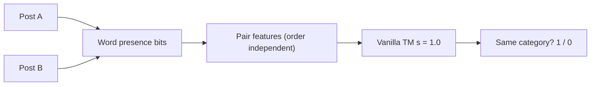

# 1. How the vanilla Tsetlin Machine works (for this project)

This file explains the ideas first, in three levels: a **child-level picture**, a **student-level explanation**, and what it means **for our experiment**. The grading criteria (Aspect II, "Understanding") reward explaining the foundation and placing it in context, so each idea below ends with the sentence you could say in the presentation.

## 1.1 The task

Take two 20 Newsgroups posts, A and B. Predict `Y = 1` if they are in the same category, otherwise `Y = 0`. The model never sees the category names, only which words appear in A and B.



## 1.2 The Tsetlin automaton: the smallest learner

**Child level:** a little creature standing on a staircase. A reward walks it deeper into its current side, a penalty walks it towards the other side. If it ends up on the top half it says "yes, include this", on the bottom half "no, leave it out".

**Student level:** a Tsetlin automaton is a finite-state machine with `2N` states and two actions. Feedback moves the state by one step. In our TM there is one automaton per *literal* per clause, and its action decides whether that literal is **included** in the clause. (bittm's default is `n_states=100`; we do not change it.)

**Presentation sentence:** "Each automaton learns one yes/no decision, include this condition in the rule or not, only from rewards and penalties."

## 1.3 Literals and clauses: the rules

Every pair gives a list of 0/1 features, for example `BOTH.space = 1` ("the word *space* is in both posts") or `ONE.hockey = 1` ("*hockey* is in exactly one of them"). A **literal** is a feature or its negation (`NOT BOTH.space`). A **clause** is an AND of included literals:

```text
IF NOT BOTH.space AND NOT BOTH.orbit AND NOT ONE.hockey THEN +1 for class "different"
```

A clause **fires** (outputs 1) only if *every* included literal is true. An empty clause is ignored at prediction time.

**Child level:** a clause is a checklist; it only gets ticked if every item is true.

## 1.4 Voting

Each class owns 100 clauses in this experiment. Half add 1 to the class score when they fire and half subtract 1. The model predicts “same category” when the class 1 score exceeds the class 0 score. A tie goes to class 0.

The figures group each clause by how firing it changes the margin `score[1] − score[0]`. For example, subtracting 1 from class 0 increases the margin by 1 and favours “same category.” Subtracting 1 from class 1 favours “different categories.”

**Presentation sentence:** "Prediction is a vote of simple rules; there are no hidden numbers to reverse-engineer, you can read every rule."

## 1.5 Learning: Type I and Type II feedback

For each training example the TM gives feedback to clauses using the standard Tsetlin Machine feedback tables (Granmo, 2018), governed by the vote threshold `T` and specificity `s`:

| Feedback | When | Intended effect & exact probabilities |
|---|---|---|
| **Type Ia** | Clause supports the target direction **and fires** (`clause = 1`) | Reinforce true literals (move toward Include) with probability `1.0` if `boost_true_positive=True`, or `(s - 1) / s` if `boost_true_positive=False`. False literals cannot exist in a firing clause. |
| **Type Ib** | Clause supports the target direction **and is silent** (`clause = 0`), or for false literals (`literal = 0`) | Penalize/forget literals (move toward Exclude) with probability `1 / s`. |
| **Type II** | Clause **fires** against the target direction (`clause = 1` on the wrong class) | Deterministically move false, excluded literals (`literal = 0`) toward Include so the clause stops firing on this false-positive pattern. |

The threshold `T` limits how much voting is useful: once the clipped vote margin `v` approaches `T`, feedback probability `(T - v) / (2T)` approaches zero, preventing a few frequent patterns from dominating all clauses.

## 1.6 Mathematical analysis of `s = 1.0` (reasoning by elimination) and why all 174,901 literals are negated

The assignment specifies `s = 1.0` for reasoning by elimination (inspired by cognitive disjunctive syllogism: *"A or B; not A; therefore B"*, Cesana-Arlotti et al., *Nature Communications* 2020). Substituting `s = 1.0` into the Type I feedback probabilities reveals two fundamental mathematical properties:

1. **Why `boost_true_positive=True` is mandatory at `s = 1.0`:**
   When `s = 1.0` and `boost_true_positive=False`, the Type Ia reinforcement probability for true literals is `(s - 1) / s = (1 - 1) / 1 = 0`. Nothing ever rewards true literals in a firing clause! Consequently, clauses drift below the inclusion threshold and collapse. Enabling `boost_true_positive=True` restores the Type Ia reinforcement probability for true literals to `1.0`.
2. **Why 100% of learned literals are negated (`NOT BOTH.w`, `NOT ONE.w`) and positive topic words are wiped out:**
   At `s = 1.0`, the Type Ib forgetting probability is `1 / s = 1.0`. Every time a clause receives Type I feedback on a training pair where a literal is `0` (False), that literal's automaton is deterministically penalized by one step toward exclusion.
   Consider a positive shared-word literal such as `BOTH.hockey`. Even among **same-category** training pairs (`Y = 1`), the 20 Newsgroups dataset is balanced across 20 distinct categories—meaning 19 out of 20 same-category pairs belong to non-hockey topics (`sci.space`, `comp.graphics`, `sci.electronics`, etc.) where `BOTH.hockey = 0`. Thus, `BOTH.hockey` is penalized on `>95%` of same-category training examples and cannot cross the `n_states = 100` inclusion barrier.
   Conversely, its negation `NOT BOTH.hockey` is `1` (True) on `>99%` of all pairs and is reinforced on almost every firing step.

In the frozen seed-42 model, **all 174,901 included conditions across the 200 clauses are negated** (`0` positive literals). The median clause has 924 conditions:

- `NOT BOTH.hockey` is true if at least one post lacks *hockey*. There are 171,351 conditions of this kind across all words.
- `NOT ONE.hockey` is true if both posts agree on *hockey* (both contain it or both lack it). There are 3,550 conditions of this kind.

The dominance of `NOT BOTH` means each clause acts as an **elimination checklist**: it fires by default on sparse pairs and is silenced when a disqualifying shared or asymmetric word appears. The net decision depends on whether more "same-supporting" or "different-supporting" checklists survive. [Measured counts](results/rules_summary.json)

## 1.7 Why `s = 1.0` outperforms larger `s` on flat pair features, and why Hierarchical TM is the next step

A natural question is whether increasing `s` (e.g., `s = 2, 3, 5, 10`) allows positive topic literals (`BOTH.word`) to survive and improves accuracy. As shown in our diagnostic study ([`03_results_and_evidence.md` §3.14](03_results_and_evidence.md)), positive literals do begin to emerge at `s = 10.0` (134 positive literals), and median clause length drops from 924 to 9.5—**but validation accuracy drops from 57.1% (`s = 1.0`) to 51.6%–54.1% (`s = 2..10`)**. Why? Because a flat 200-clause pool cannot cover thousands of sparse topic-word pairs across 20 categories using short positive conjunctions. At the single-layer level, `s = 1.0` elimination checklists extract more signal than `s > 1.0`. Overcoming the 20-category cross-elimination bottleneck requires a **Hierarchical Tsetlin Machine** (Stage 2), where Level 1 first groups words into category/topic concepts (`space OR orbit OR nasa`) before Level 2 compares the two documents.

## 1.8 Why the input representation matters

The first version of the pair features was `[A words | B words]`. To say "the posts share the word *hockey*", a clause would need `A.hockey AND B.hockey` and that is a separate pair of literals for every word. We changed the input to `[in BOTH | in exactly ONE]`. Now "shared word" is one literal, and swapping A and B changes nothing.

```text
Vocabulary:      space   orbit   hockey
Post A:            1       1       0
Post B:            1       0       1
BOTH   (A AND B):  1       0       0
ONE    (A XOR B):  0       1       1
TM input:       [1,0,0 | 0,1,1]
```

## 1.9 Where this fits in the bigger picture (Aspect II context)

- **Deep learning / LLMs** learn dense vectors from data; the knowledge is spread across millions of numbers and is hard to read.
- **Logical learning** with Tsetlin Machines learns propositional rules (AND of literals) that can be inspected. The course material cites a convergence result (ICLR 2026, Zhang, Jiao and Granmo) showing that TMs converge to the correct k-bit AND operators under noise-free training.
- **Our result so far:** on this hard pair task the vanilla TM is weak and a simple TF-IDF baseline is better. That is a valid, honest finding. It motivates the next assignment steps (a hierarchical TM, richer features).

## 1.10 Three-level glossary

| Term | Child level | Student level |
|---|---|---|
| Literal | One tick-box on the checklist | A feature or its negation |
| Clause | A checklist of tick-boxes | AND of included literals |
| Vote | A checklist speaking for or against its class | A fired clause adds or subtracts one from its class score |
| `T` | Volume limit on the shouting | Target vote sum that limits feedback |
| `s` | How picky the checklist is | Specificity; `1.0` means elimination |
| Boost | Always reward true ticks | `boost_true_positive` |
| Epoch | One lesson over all examples | One pass over the training rows |
