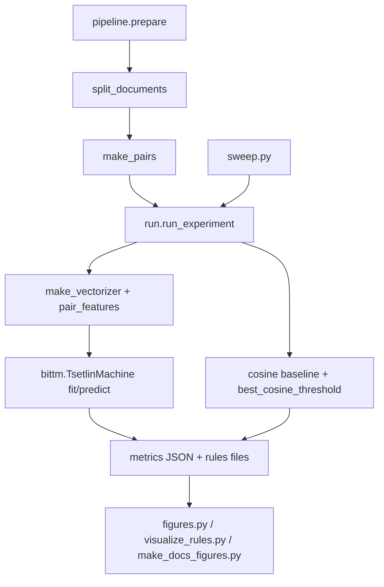

# 2. Code walkthrough: what each file does and why

Read this with the code open. File and function names are exact.

## 2.1 `pipeline.py`: data, pairs, features

| Function | What it does | Why |
|---|---|---|
| `split_documents` | Loads the standard train/test split, sets aside 20% of train as validation (stratified), then removes exact duplicate texts across partitions (priority test > validation > train) | Prevents the same post from appearing in train and evaluation |
| `make_pairs` | Samples balanced same/different pairs from one split; training pairs are added in both orientations (`augment=True`) | Equal class sizes make accuracy meaningful (chance is 0.50) |
| `reverse_pair` | Swaps A and B | Used to measure order consistency |
| `make_vectorizer` | Builds the word-presence vectorizer (`count`) or the TF-IDF vectorizer used by the baseline. `vocab_mode='letters'` keeps only words of 3+ letters | Numbers such as "1990" say nothing about topic |
| `pair_features` | Turns pairs into the TM's 0/1 matrix. `mode='ab'` is `[A|B]`; `mode='sym'` is `[in both | in exactly one]` | `sym` makes the input independent of the A/B order and makes "shared word" a single literal |
| `feature_names` | Gives readable names (`BOTH.space`, `ONE.hockey`) matching the matrix columns | Lets learned rules be read |
| `metrics` | Accuracy, precision, recall, F1, confusion matrix | Standard evaluation |
| `cosine_scores` | TF-IDF cosine similarity for each pair | Baseline |
| `best_cosine_threshold` | Cut-off with the highest **accuracy** on validation | Fixed bug, see below |
| `auc` | Area under the ROC curve of the cosine score | Threshold-free comparison |

### The baseline bug that was fixed

The old code chose the cosine cut-off by **F1**. On balanced pairs, "call everything a match" already has F1 = 0.667, so the cut-off became 0 and the baseline looked like chance (0.500). That made the TM look comparable to a baseline that was actually working (about 0.60). It is now chosen by accuracy, and the test `test_cosine_threshold_uses_accuracy_not_all_positive` protects it.

The cut-off is tuned on the validation pairs, so the validation score of the baseline is slightly optimistic. For the final test, the cut-off is still the validation one.

## 2.2 `run.py`: one experiment

`run_experiment(cfg, parts, pairs, out, final_test)`:

1. Fit the vocabulary on **training documents only**.
2. Build pair features for training pairs (`x`) and labels (`y`).
3. Train `bittm.TsetlinMachine` with `s = 1.0`, unweighted, fixed seed.
4. Fit the TF-IDF baseline and choose its cut-off on validation pairs.
5. Evaluate on validation (default) or on test (`--final-test`).
6. Measure `order_consistency`: how often the prediction is unchanged if A and B are swapped.
7. Save metrics JSON and the learned rules (`*_rules.txt` top 30, `*_rules_all.txt` all clauses).

Defaults are the best settings found on validation: `--features sym --vocab-mode letters --boost 1`. To reproduce the very first run use `--features ab --vocab-mode default --boost 0 --threshold 50`.

`--seed` only changes the TM's random start. Documents and pairs always use data seed 42, so different seeds are comparable.

## 2.3 `sweep.py`: ablation and settings sweep

`python sweep.py ablation` switches the changes on one at a time. `python sweep.py sweep` varies clauses, `T` and vocabulary size around the best base. Each configuration runs with 3 TM seeds and stores mean and standard deviation in `docs/results/*.json` and `*.csv`. The test split is never scored.

## 2.4 `visualize_rules.py`, `figures.py`, `make_docs_figures.py`

- `visualize_rules.py` reads `*_rules_all.txt` and draws clause length, "NOT vs present" counts and the most-required words.
- `figures.py` draws the accuracy bars and the confusion matrix for one metrics JSON.
- `make_docs_figures.py` draws the comparison charts used in `docs/`.

## 2.5 Tests (`tests/test_pipeline.py`)

| Test | Protects |
|---|---|
| `test_pairs_balanced_unique_and_reproducible` | Balanced, unique, repeatable pairs |
| `test_augmentation_has_reverse_once` | Each training pair appears once in each orientation |
| `test_metrics` | Metric formulas |
| `test_split_removes_cross_split_exact_duplicates` | No leakage across splits |
| `test_sym_features_do_not_depend_on_order` | Swapping A and B changes nothing in `sym` |
| `test_sym_features_mean_both_and_one` | `BOTH` and `ONE` mean what we say |
| `test_letters_vocabulary_drops_numbers` | Numbers are removed |
| `test_cosine_threshold_uses_accuracy_not_all_positive` | The baseline bug stays fixed |

Run with `python -m pytest tests -q`.

## 2.6 One thing to know about augmentation

Training pairs are used in both orientations. For `sym` features the two orientations produce **identical** rows, so every training row is seen twice per epoch. This repeats each unordered example during training. The effect of removing the second orientation needs a separate experiment. It was kept so results stay comparable with the first run.

## 2.7 Known limitations

- Validation and test pairs are a fixed random sample; a different sample would shift scores by a little.
- Near-duplicate posts (quotes, forwards) are not removed, only exact duplicates.
- The hierarchical TM is not part of this version.
