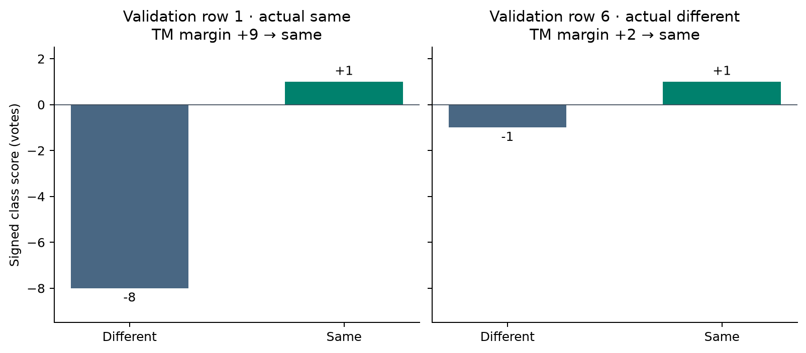

# How a vanilla TM decides on two real pairs

Both pairs share exactly one word from the TM vocabulary. TF-IDF cosine calls both pairs “different.” The seed-42 vanilla TM calls both “same.” The first pair really does belong to one category. The second brings together two unrelated topics.



The **TM** builds 1,000 shared-word bits and 1,000 bits for words in exactly one post. Each firing clause contributes to a class score. Subtract the “different” score from the “same” score to get the margin. A positive margin predicts “same,” and a tie predicts “different.” The training setting `T=25` controls feedback. For the **cosine baseline**, a score of at least **0.03721026** predicts “same.” Its vocabulary is fitted separately on the training posts.

## A true match that cosine misses

Validation row **1** pairs `train:4238` with `train:3109`. One post asks about printed circuit board layout software. The other describes a homemade battery. Both belong to **sci.electronics**. Although their technical subjects are related, their only shared word in the TM vocabulary is **wondering**. There are 41 TM vocabulary words present in exactly one post. The TF-IDF vocabulary has no shared term here, so cosine gives **0.00000**, below the cutoff.

Nine of the TM’s 200 learned clauses fire. Eight subtract a vote from “different” and one adds a vote to “same.” The resulting scores are **−8 and +1**, giving a margin of **+9**. Clause 50, for example, contributes `[-1, 0]` after all 765 of its conditions pass. Its first three conditions in feature order require that **ability**, **absolutely** and **accept** each be absent from at least one post. Clause 0 instead requires `NOT BOTH.wondering`; this condition fails because both posts contain the word. The model reaches the correct category decision through these votes. None of the nine votes identifies a shared electronics term.

## A false match that cosine rejects

Validation row **6** pairs `train:2047`, an advertisement for a video graphics card in **misc.forsale**, with `train:4881`, a discussion of the Magi in **talk.religion.misc**. Their only shared TM vocabulary word is **doing**, with 173 words present in exactly one post. Their TF-IDF cosine score is **0.00676**, also below the cutoff.

Two clauses fire. One subtracts a vote from “different” and one adds a vote to “same.” The scores are **−1 and +1**, giving a margin of **+2**. Clause 75 contributes `[-1, 0]` after all 729 of its conditions pass. Clause 0 again stays silent, this time because `NOT BOTH.doing` fails. The two votes suffice for a “same” prediction even though the category labels differ. This illustrates how a checklist of absences can fit posts on unrelated topics.

## How to verify the examples

The script takes the first row of each true label in validation-manifest order where the TM predicts “same,” cosine predicts “different,” and exactly one TM vocabulary word is shared. Both categories and document IDs come from that manifest. The `train:` prefix refers to the original dataset partition from which these validation documents were reserved. Row and clause numbers start at zero. The example firing clause is the lowest index for its direction of vote. The silent clause is the lowest index with a failed condition. These deliberately selected disagreements illustrate model behavior. Use the full validation metrics to compare accuracy.

Run the following PowerShell command from the project root after generating the frozen manifests in `outputs/vanilla-v2`. It reads the full validation posts, the saved seed-42 cutoff, and the packed weights in `docs/dashboard_data.json`. It checks that both classifiers reproduce their saved confusion matrices and that the printed clause sums equal BitTM’s native class scores for the examples. The command regenerates the figure and [machine-readable trace](results/worked_pairs.json).

```powershell
.\.venv\Scripts\python.exe explain_validation_pairs.py
```
